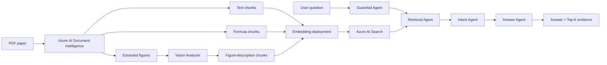

# PaperLens — Multimodal Research Paper Assistant

PaperLens is an Azure-powered research reading assistant that turns PDF papers
into a searchable, explainable knowledge base. It extracts document text,
mathematical formulas, and figures; creates vector embeddings; retrieves the
most relevant evidence with hybrid search; and answers questions through a
multi-agent RAG workflow.

Unlike a generic document chatbot, PaperLens exposes its retrieval trace. Every
answer can be inspected alongside the Top-K text, equation, and figure chunks
that supported it.

> [!IMPORTANT]
> **Bring Your Own Azure:** this repository does not provide a shared hosted
> backend, shared API keys, or access to the maintainer's Azure subscription.
> Each user must deploy the application with resources and credentials from
> their own Azure subscription. Cloning the repository alone cannot consume
> the maintainer's Azure credits.

> This repository is an independent extension of
> [`dukewillbe185/multiagent-rag`](https://github.com/dukewillbe185/multiagent-rag).
> See [Acknowledgments](#acknowledgments) for attribution.

## Highlights

- **Multimodal PDF ingestion** — extracts text, layout, formulas, and figures
  with Azure AI Document Intelligence.
- **Equation-aware retrieval** — stores detected LaTeX, page number, formula
  type, and confidence as searchable chunks.
- **Figure understanding** — sends meaningful paper figures to a vision-capable
  Azure OpenAI deployment and indexes structured visual descriptions.
- **Decoration filtering** — excludes small publisher logos, buttons, and page
  ornaments before vision analysis.
- **Hybrid Top-K search** — combines BM25 keyword search with HNSW vector
  similarity in Azure AI Search.
- **Single-paper scope** — optionally restricts retrieval and answer generation
  to one selected PDF.
- **Transparent evidence** — returns content type, source file, page number,
  score, preview, and full retrieved content.
- **Measured RAG quality** — evaluates labelled questions with Precision@K,
  Recall@K, MRR, and optional LLM-judged answer faithfulness.
- **Multi-agent reasoning** — guardrail, retrieval, intent classification, and
  answer generation are orchestrated with LangGraph.
- **Conversation memory** — keeps the previous question and answer for follow-up
  questions within a session.
- **PaperLens web interface** — provides paper upload, paper selection, chat,
  processing state, and an Evidence Inspector for Top-K results.
- **Keyless local development** — supports Azure CLI authentication so secrets
  do not need to be stored in the repository.

## User Interface

Run the server and open `http://127.0.0.1:8000` to use PaperLens.

The interface is divided into three clear work areas:

| Area | Purpose |
| --- | --- |
| **Paper Library** | Upload PDFs, view indexed papers, and select the active paper. |
| **Reading Workspace** | Ask questions about methods, equations, figures, results, or limitations. |
| **Evidence Inspector** | Inspect the Top-K chunks, content type, page number, retrieval score, and full evidence. |

The responsive layout changes the paper library into a compact horizontal
selector on small screens.

## Architecture



### Document pipeline

1. Azure AI Document Intelligence analyzes the PDF with the Layout model.
2. Text is split into overlapping chunks.
3. Detected formulas become independent LaTeX-aware chunks.
4. Extracted figures are filtered to remove small decorative images.
5. A vision-capable model produces a structured explanation for selected figures.
6. Text, formula, and figure chunks receive 1,536-dimensional embeddings.
7. Chunks and metadata are written to an Azure AI Search vector index.

### Query workflow

1. The input guardrail checks whether the question is safe and relevant.
2. The retrieval agent performs hybrid keyword and vector search.
3. The intent agent classifies the request.
4. The answer agent generates a grounded response from the retrieved evidence.
5. The output guardrail checks the generated answer before delivery.
6. The API returns the answer and a transparent Top-K retrieval trace.

## Technology Stack

| Layer | Technology |
| --- | --- |
| Frontend | HTML, CSS, and vanilla JavaScript |
| API | FastAPI and Pydantic |
| Agent workflow | LangGraph and LangChain |
| PDF understanding | Azure AI Document Intelligence |
| Language and vision models | Azure OpenAI / Microsoft Foundry deployments |
| Embeddings | `text-embedding-3-small` |
| Search | Azure AI Search hybrid vector search |
| Authentication | Azure CLI / Microsoft Entra ID or API keys |
| Testing | pytest |

## Prerequisites

### Local tools

- Python 3.10 or later
- Git
- Azure CLI
- An Azure subscription with permission to use the resources below

### Azure resources

You need:

1. **Azure AI Document Intelligence**
   - S0 is required for paid add-on features such as formula extraction.
2. **Azure OpenAI or Microsoft Foundry resource**
   - one text embedding deployment, recommended: `text-embedding-3-small`
   - one vision-capable chat deployment, for example `gpt-4.1-mini`
3. **Azure AI Search**
   - vector search enabled
4. **Azure AI Content Safety** — optional
5. **Application Insights** — optional and disabled locally by default

For Azure CLI authentication, the signed-in identity needs appropriate RBAC
roles. Typical development roles include:

- `Cognitive Services User`
- `Cognitive Services OpenAI User`
- `Search Service Contributor`
- `Search Index Data Contributor`

Use least-privilege roles appropriate to your environment.

## Bring Your Own Azure Model

PaperLens is distributed as self-hosted source code. The frontend calls the
FastAPI backend on the same origin, and that backend calls the Azure resources
configured by the person running it.

- There is no maintainer-operated public API.
- No credentials, endpoints, PDFs, or Azure resource IDs are bundled with the
  repository.
- `.env` is ignored by Git and must be created locally by each user.
- Every Document Intelligence, Azure OpenAI, Vision, and AI Search request is
  billed to the subscription configured by that user.
- GitHub Pages alone cannot run the RAG application because it cannot host the
  Python API or securely store Azure credentials.

For cloud hosting, fork the repository and deploy both the frontend and FastAPI
backend into your own Azure account. See [Self-hosted deployment](DEPLOYMENT.md).

## Quick Start

### 1. Clone the repository

```bash
git clone https://github.com/RuoxiSun15/research-paper-rag-assistant.git
cd research-paper-rag-assistant
```

### 2. Create a virtual environment

```bash
python3 -m venv .venv
source .venv/bin/activate
python -m pip install --upgrade pip
pip install -r requirements.txt
```

Windows PowerShell activation:

```powershell
.venv\Scripts\Activate.ps1
```

### 3. Sign in to Azure

```bash
az login
az account set --subscription "<subscription-name-or-id>"
az account show --output table
```

### 4. Configure the application

```bash
cp .env.example .env
```

Edit `.env` with your own endpoints and deployment names. Never commit `.env`.

The recommended local configuration uses Azure CLI authentication:

```dotenv
# Document Intelligence
AZURE_DOCUMENT_INTELLIGENCE_ENDPOINT=https://<resource>.cognitiveservices.azure.com/
AZURE_DOCUMENT_INTELLIGENCE_USE_AZURE_CLI=true
FORMULA_EXTRACTION_ENABLED=true
FIGURE_EXTRACTION_ENABLED=true
FIGURE_OUTPUT_DIR=tmp/figures

# Vision-capable chat model
VISION_ANALYSIS_ENABLED=true
AZURE_VISION_ENDPOINT=https://<resource>.openai.azure.com/
AZURE_VISION_DEPLOYMENT_NAME=<vision-deployment-name>
AZURE_VISION_USE_AZURE_CLI=true
AZURE_VISION_API_VERSION=2024-10-21
VISION_MAX_FIGURES_PER_DOCUMENT=5

# Embeddings
AZURE_AI_FOUNDRY_EMBEDDING_ENDPOINT=https://<resource>.openai.azure.com/
AZURE_AI_FOUNDRY_EMBEDDING_DEPLOYMENT_NAME=text-embedding-3-small
AZURE_AI_FOUNDRY_EMBEDDING_USE_AZURE_CLI=true
AZURE_AI_FOUNDRY_EMBEDDING_API_VERSION=2024-10-21

# Answer generation
AZURE_AI_FOUNDRY_GPT4_ENDPOINT=https://<resource>.openai.azure.com/
AZURE_AI_FOUNDRY_GPT4_DEPLOYMENT_NAME=<chat-deployment-name>
AZURE_AI_FOUNDRY_GPT4_USE_AZURE_CLI=true
AZURE_AI_FOUNDRY_GPT4_API_VERSION=2024-10-21

# Azure AI Search
AZURE_SEARCH_ENDPOINT=https://<search-service>.search.windows.net
AZURE_SEARCH_INDEX_NAME=rag-documents-index
AZURE_SEARCH_USE_AZURE_CLI=true
AZURE_SEARCH_API_VERSION=2024-07-01

# RAG settings
CHUNK_SIZE=1200
CHUNK_OVERLAP=0.2
RETRIEVAL_TOP_K=5
LLM_TEMPERATURE=0.7
SESSION_TIMEOUT_MINUTES=30
CONVERSATION_MEMORY_TURNS=1

# Optional monitoring
ENABLE_APP_INSIGHTS_LOGGING=false
```

API-key authentication is also supported. Set the relevant
`*_USE_AZURE_CLI=false` value and provide the matching key in `.env`.

### 5. Start PaperLens

```bash
python -m uvicorn src.api.main:app --host 127.0.0.1 --port 8000
```

Open:

- **PaperLens UI:** http://127.0.0.1:8000
- **Swagger API:** http://127.0.0.1:8000/docs
- **ReDoc:** http://127.0.0.1:8000/redoc

The first startup can take longer in some local environments because the agent
and PDF-processing dependencies are imported before the API becomes ready.

## Using PaperLens

### Web interface

1. Open the PaperLens UI.
2. Import a PDF from the Paper Library.
3. Wait for layout analysis, formula/figure extraction, embeddings, and indexing.
4. Select the paper in the library.
5. Ask a question in the Reading Workspace.
6. Expand evidence cards in the Evidence Inspector to inspect the Top-K matches.

Example questions:

- `Summarize the paper's three main contributions.`
- `Explain the proposed method and its overall workflow.`
- `What does the trust-value generation figure show?`
- `Explain the key equations and variables.`
- `What limitations are identified by the authors?`

### Command-line interface

Process a PDF:

```bash
python main.py process /path/to/paper.pdf
```

Test retrieval across the whole index:

```bash
python main.py retrieve "What is the main contribution?" --top-k 5
```

Restrict retrieval to one paper:

```bash
python main.py retrieve \
  "How is the overall trust value calculated?" \
  --source-file "paper.pdf" \
  --top-k 5
```

Run the multi-agent query workflow:

```bash
python main.py query \
  "Explain the method used in this paper." \
  --source-file "paper.pdf"
```

Inspect the search index:

```bash
python main.py index status
```

## API

### Health check

```http
GET /api/v1/health
```

### List indexed papers

```http
GET /api/v1/documents
```

Example response:

```json
{
  "documents": [
    {"source_file": "paper.pdf", "chunk_count": 42}
  ]
}
```

### Upload a paper

```http
POST /api/v1/upload
Content-Type: multipart/form-data
```

```bash
curl -X POST "http://127.0.0.1:8000/api/v1/upload" \
  -F "file=@/path/to/paper.pdf"
```

Example response:

```json
{
  "success": true,
  "message": "Document processed successfully",
  "file_name": "paper.pdf",
  "chunks_created": 128,
  "chunks_indexed": 128,
  "formulas_detected": 34,
  "figures_detected": 8,
  "figures_analyzed": 5,
  "processing_time_seconds": 76.4
}
```

### Ask a question

```http
POST /api/v1/query
Content-Type: application/json
```

```bash
curl -X POST "http://127.0.0.1:8000/api/v1/query" \
  -H "Content-Type: application/json" \
  -d '{
    "question": "What does the main workflow figure show?",
    "session_id": "demo-session",
    "source_file": "paper.pdf",
    "top_k": 5,
    "metadata": {"source": "curl"}
  }'
```

Each retrieved chunk includes:

- `chunk_id`
- `source_file`
- `chunk_index`
- `content_type` (`text`, `formula`, or `figure`)
- `page_number` when available
- `score`
- `content_preview`
- `full_content`

### Index operations

```http
GET  /api/v1/index/status
POST /api/v1/index/create?recreate=false
```

## Project Structure

```text
multiagent-rag/
├── frontend/
│   ├── index.html                # PaperLens interface
│   ├── styles.css                # Responsive three-zone layout
│   └── app.js                    # Upload, chat, and evidence UI
├── config/
│   └── azure_config.py           # Environment validation and settings
├── scripts/
│   └── resume_document_analysis.py
├── evaluation/
│   └── dataset.example.json      # Labelled evaluation-set template
├── src/
│   ├── agents/
│   │   ├── base_agent.py
│   │   └── rag_agent.py          # LangGraph multi-agent workflow
│   ├── api/
│   │   ├── main.py               # FastAPI app and frontend hosting
│   │   ├── models.py
│   │   └── routes.py
│   ├── data_pipeline/
│   │   ├── document_extractor.py
│   │   ├── text_chunker.py
│   │   ├── formula_parser.py
│   │   ├── figure_parser.py
│   │   ├── vision_analyzer.py
│   │   ├── embedder.py
│   │   └── indexer.py
│   ├── guardrails/
│   ├── evaluation/               # Retrieval metrics and faithfulness judge
│   ├── monitoring/
│   ├── retrieval/
│   └── utils/
├── tests/
├── main.py                       # CLI entry point
├── requirements.txt
├── .env.example
└── README.md
```

## Testing

Run the automated tests:

```bash
pytest -q
```

The current tests cover:

- source-file OData filter escaping
- formula metadata and formula chunks
- figure metadata and searchable figure chunks
- decorative-image filtering
- structured vision analysis formatting
- Azure CLI token parsing
- Precision@K, Recall@K, and reciprocal-rank calculations
- structured faithfulness-judge response parsing

## RAG Evaluation

PaperLens includes a repeatable evaluation command for measuring retrieval and
answer grounding. Start by copying the template:

```bash
cp evaluation/dataset.example.json evaluation/my_dataset.json
```

For each question, replace `relevant_chunk_ids` with the IDs of the chunks that
should answer that question. Chunk IDs are visible in the API query response
and the Evidence Inspector. A dataset can contain multiple cases:

```json
[
  {
    "id": "method-001",
    "question": "What is the paper's main method?",
    "source_file": "example-paper.pdf",
    "relevant_chunk_ids": ["example-paper_pdf_chunk_4"]
  }
]
```

Run the inexpensive retrieval-only evaluation first:

```bash
python main.py evaluate evaluation/my_dataset.json --top-k 5
```

For an embedding deployment with minimal capacity, space requests apart:

```bash
python main.py evaluate evaluation/my_dataset.json --top-k 5 --case-delay 12
```

This writes a detailed JSON report to `evaluation/results/latest.json` and
prints mean Precision@5, Recall@5, and MRR@5. To also generate answers and ask
the configured Azure chat model to judge whether every factual claim is
supported by the retrieved passages, add:

```bash
python main.py evaluate evaluation/my_dataset.json --top-k 5 --faithfulness
```

Faithfulness mode uses additional model calls and therefore may incur Azure
cost. The judge returns a score from 0 to 1 plus supported and unsupported
claims. Review low-scoring cases manually; an LLM judge is a useful signal, not
an unquestionable ground truth.

For a low-cost Azure smoke test, use a small PDF or limit the number of figures
sent to the vision model:

```dotenv
VISION_MAX_FIGURES_PER_DOCUMENT=1
```

## Reliability and Cost Controls

- Azure 429 responses trigger bounded retries with wait intervals.
- Temporary embedding connection failures are retried.
- Vision analysis is capped per document.
- Decorative images are filtered before billable vision calls.
- Embeddings are sent in controlled batches.
- `.env`, temporary PDFs, extracted figures, and PDF files are excluded from Git.
- Use an Azure Budget and cost alerts for development subscriptions.

Azure budgets provide alerts; they do not automatically stop resources when the
threshold is reached. Delete or disable unused paid resources when testing ends.

## Security

- Never commit `.env`, API keys, access tokens, or service credentials.
- Prefer Azure CLI or Managed Identity authentication over long-lived keys.
- Use least-privilege RBAC roles.
- Keep Azure AI Search admin keys out of browser-side code.
- Do not expose this development API publicly without authentication,
  authorization, rate limiting, restricted CORS, and secure file validation.
- Application Insights logging is opt-in locally through
  `ENABLE_APP_INSIGHTS_LOGGING=true`.

## Current Limitations

- Inline formula OCR can be noisy or incomplete when equations are embedded in
  dense prose. Formula-context merging and quality scoring remain future work.
- Vision descriptions are model-generated and should be verified against the
  original figure.
- The web UI does not yet include an embedded PDF page viewer.
- Uploaded PDFs are processed from temporary storage and are not retained by
  the application after ingestion.
- Session memory is held in-process and is not shared across server instances.
- Upload processing is synchronous; large papers may take several minutes.
- Azure service quotas can affect ingestion speed on low-capacity deployments.

## Roadmap

- [x] Paper-specific retrieval
- [x] Formula extraction and LaTeX-aware chunks
- [x] Figure extraction and image storage
- [x] Vision-based figure interpretation
- [x] Text, formula, and figure retrieval metadata
- [x] Responsive PaperLens web interface
- [x] Evidence Inspector for Top-K transparency
- [ ] Embedded PDF viewer with page-level navigation
- [ ] Table-aware extraction and structured table retrieval
- [ ] Formula quality filtering and surrounding-context linking
- [ ] Background ingestion jobs with live progress events
- [ ] Persistent user accounts and document libraries
- [x] Retrieval evaluation with Precision@K, Recall@K, MRR, and answer faithfulness
- [ ] Containerized deployment and CI/CD

## Research Document and Copyright Notice

Publisher PDFs are not included in this repository. The system has been tested
locally with research papers, including:

- Ruoxi Sun et al., *Improving the recommendation accuracy of TrustSVD via
  trustworthy analysis in the social network environment*, Journal of
  Information Science. DOI:
  [10.1177/01655515221136221](https://doi.org/10.1177/01655515221136221)

Public availability of an article does not necessarily grant permission to
redistribute the publisher-formatted PDF. Before committing a test paper, check
the publisher policy and the rights attached to the specific manuscript version.
Use an accepted manuscript, an openly licensed paper, or a synthetic test PDF
when redistribution permission is unclear.

## Troubleshooting

### `Address already in use`

Another process is already listening on port 8000. Stop it or choose another
port:

```bash
python -m uvicorn src.api.main:app --host 127.0.0.1 --port 8001
```

### `No subscriptions found`

The signed-in Azure account has no accessible subscription. Confirm the tenant
and ask the subscription administrator to grant access:

```bash
az account tenant list --output table
az account list --all --output table
```

### HTTP 401 or 403 from Azure

Confirm that:

1. Azure CLI is signed in to the correct tenant and subscription.
2. The account has the required RBAC role on each resource.
3. The endpoint and deployment name match the selected resource.
4. Role assignments have had time to propagate.

### HTTP 429 rate limit

The selected deployment has reached its request or token quota. PaperLens waits
and retries bounded requests automatically. For repeated limits, reduce the
number of analyzed figures, lower the ingestion sample size, increase deployment
capacity, or request additional quota.

### Formula or figure results look incorrect

- Compare the extracted result with the original page.
- Confirm formula and figure features are enabled.
- Check that the image is a meaningful paper figure rather than a page ornament.
- Treat model-generated visual descriptions as interpretations, not ground truth.

## Acknowledgments

- Original multi-agent RAG foundation:
  [`dukewillbe185/multiagent-rag`](https://github.com/dukewillbe185/multiagent-rag)
- Microsoft Azure AI Document Intelligence, Azure OpenAI, and Azure AI Search
- FastAPI, LangChain, and LangGraph open-source communities

## Contributing

Issues and pull requests are welcome. Please avoid including copyrighted PDFs,
credentials, generated temporary files, or Azure resource identifiers in commits.
Add or update tests for behavioral changes.

## License

No license file is currently included. Add an explicit open-source license before
inviting reuse or redistribution of the repository.
